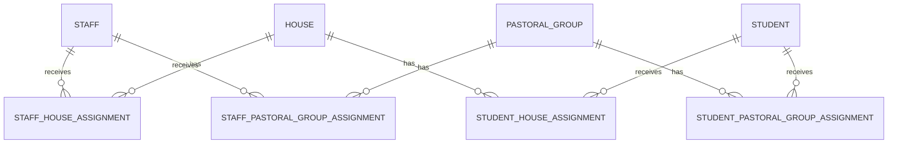

# Organisation and pastoral assignment architecture

The `org` schema separates reference entities from temporal relationships:

- `org.Staff`, `org.House`, and `org.PastoralGroup` preserve source identifiers.
- Student and staff assignment tables retain every historical interval. Student
  keys are `BIGINT` to match the local `gold.dimStudent` master.
- `EffectiveFrom`/`EffectiveTo` define current membership; a NULL `EffectiveTo`
  means open-ended.
- A current lookup only returns a relationship when exactly one current primary
  row exists. Multiple primary rows are reported as conflicts and produce NULL
  relationship values rather than an arbitrary staff member.
- Migration staging tables are verified-input boundaries for the four named
  legacy sources and the authoritative student/staff masters.

The authoritative student and staff dimensions remain outside `org`; foreign
keys validate those master keys. `org.Staff.MasterStaffKey` maps an organisation
employee to the existing staff master while `SourceSystem` and source IDs
provide traceability and idempotency.
